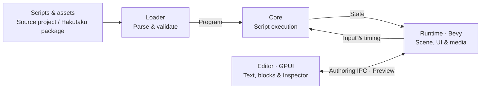

Kēne is a visual novel engine with a native desktop editor. Write scripts in
Eiyashou (`.shou`), edit them as text or blocks, and preview your game in the Engine.
The text editor, block view and Inspector all work on the same script.

Built with Rust, Bevy and GPUI. Games are packaged with Hakutaku v2 and use
WebP images and Ogg Opus audio. Existing LetsGal Studio projects can be imported;
WebGAL support is limited to the [documented compatibility features](dev/docs/compatibility.md).

[简体中文](dev/docs/readme.zh.md)

## Downloads

- [Editor](https://github.com/maincoretech/keine/releases/tag/editor-latest) — includes the matching Engine for previews. Updated after Desktop CI passes on `main`.
- [tday demo](https://github.com/maincoretech/keine/releases/tag/tday-latest) — a playable sample. New builds are published manually through **Build tday**.

To package your own game, see the [publishing guide](dev/docs/release.md).

## Build and run

Install the native libraries listed in the [development guide](dev/docs/testing.md#开发环境).
The repository pins Rust 1.99.0; the engine uses Bevy 0.20.0.

```sh
cargo build --locked -p keine --bin keine --features video-native,video-ffmpeg
cargo editor projects/tday
cargo validate tests/fixtures/native-smoke
cargo dev tests/fixtures/native-smoke
```

Build the Engine before using Editor Preview. The Editor opens it in a separate
window and does not compile it for you. These commands enable FFmpeg;
macOS uses its native video backend when available.

`projects/tday/` is a finished demo. Make a copy if you want to experiment with it.
Small test projects live in `tests/fixtures/`. To convert an existing project,
see [migration commands](dev/docs/release.md#cli); compatibility JSON is read-only
in the Editor, and conversion preserves the original project.

## Architecture



Core and Loader are independent of Bevy. The Editor shares their script model
and runs previews in a separate Engine process. See [architecture](dev/docs/architecture.md)
for module boundaries and [benchmark notes](dev/docs/testing.md#0163-解析优化与四引擎脚本对照)
for performance measurements.

## Repository

```text
crates/       core, loader, authoring protocol, Editor, media
src/          engine; all embedded resources in src/assets/
tests/        integration tests, fixtures, benchmarks, fuzzing and video tests
dev/docs/     guides and reference
dev/scripts/  build and release scripts
```

## Script performance

Tested on **Apple M5 Pro (15 logical CPUs), 24 GiB RAM, macOS 27.0.1** on
October 16, 2026. These results use 0.16.3 with the parser improvements later
released in 0.16.4; they have not been rerun for 0.17.1.

In the Criterion benchmark, those changes reduced parsing time from
**85.26 to 75.09 ms** for 100,000 text statements, and from **2.27 to 2.13 ms**
for the tday script's 2,626 actions.

The comparison below ran equivalent scripts on the same machine, on one thread,
with input already in memory. Each figure is the median of three runs.

| Engine / script implementation | Parse 10k text statements | Parse 10k assignments | Execute 10k increments |
| --- | ---: | ---: | ---: |
| Kēne / EYS, optimized 0.16.3 | 5.98 ms | 4.40 ms | 0.65 ms |
| TyranoScript `c8dbfd4`, V8 / Node 24.22 | 2.50 ms | 7.01 ms | 0.77 ms |
| Suika3 26.07.13, C tag path | 1.06 ms | 1.77 ms | 16.49 ms |
| Ren'Py 8.5.3, SDK Python 3.12 | 81.65 ms | 63.23 ms | 3.74 ms |

Only script parsing and execution were timed; loading files, rendering, audio and
other game systems were excluded. The parsers perform different checks, so these
figures won't tell you which engine starts a game faster or runs it more smoothly.
Suika3's NoctLang/JIT was not tested. See the [benchmark notes](dev/docs/testing.md#0163-解析优化与四引擎脚本对照)
for the test setup, limitations, raw results and commands.

## Documentation

- [Architecture](dev/docs/architecture.md)
- [Eiyashou v2.0](dev/docs/language.md)
- [Editor](dev/docs/editor.md)
- [Development and testing](dev/docs/testing.md)
- [Publishing](dev/docs/release.md)
- [Android](dev/docs/android.md)
- [Project compatibility](dev/docs/compatibility.md)

Current version: **0.17.1**. Recent manual testing has focused on macOS;
Windows and Linux still need a fresh runtime check. CI results alone do not confirm
that input, display and media playback work correctly on a device.

## License

Kēne's code and documentation are available under the [Defold License 1.0](LICENSE).
You may make and sell games with Kēne. Commercial use of the engine or Editor as a
game engine product is restricted by the license.

Third-party libraries and assets have their own licenses, listed in [NOTICE](NOTICE).
The tday scripts and media belong to shiftz; see the [demo license](projects/tday/LICENSE).
Contributions use the same license as Kēne unless agreed otherwise.
